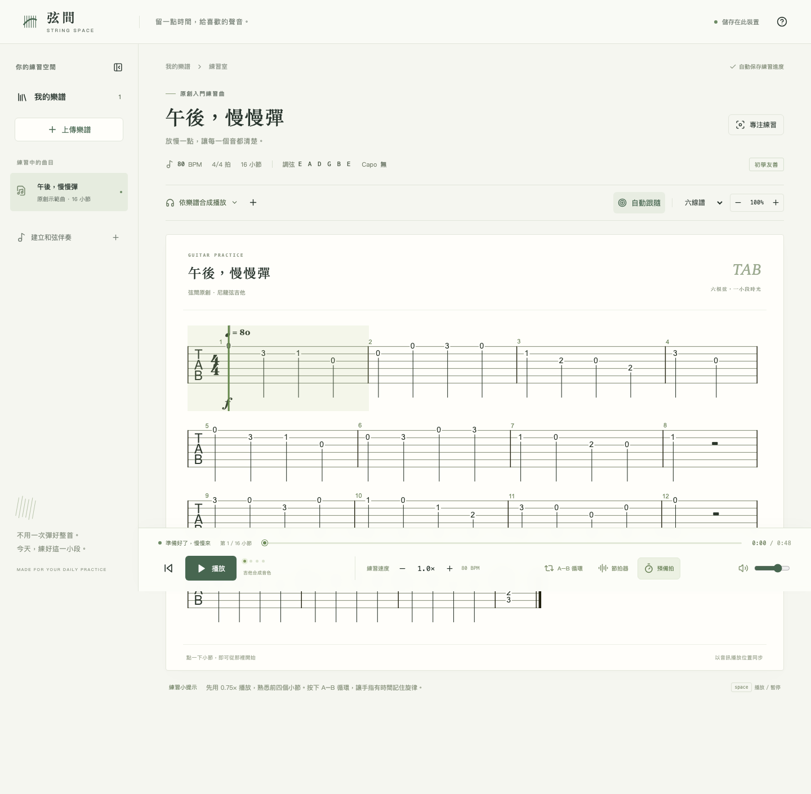
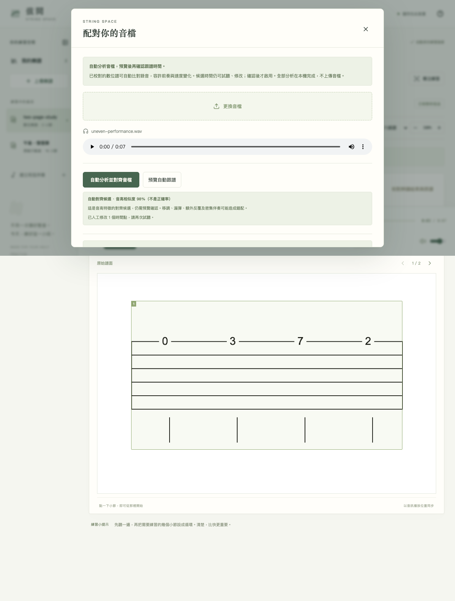

# 弦間 String Space

繁體中文、免登入的吉他練習網站：匯入樂譜、合成播放、慢速循環，或把自己的錄音自動對齊 PDF，再跟著原譜練習。

[GitHub 原始碼](https://github.com/clark970417-eng/string-space) · [實際測試紀錄](TEST_REPORT.md)



## 開始使用

需要 Node.js 22.12 以上（建議 Node.js 24）及 npm。

```sh
git clone https://github.com/clark970417-eng/string-space.git
cd string-space
npm ci
npm run dev
```

開啟 <http://localhost:5178/>。按播放即可練習原創 16 小節示範曲〈午後，慢慢彈〉。若埠號已被使用，可執行 `npm run dev -- --port 5189`。

```sh
npm run build
npm run preview -- --port 4178
```

正式預覽為 <http://localhost:4178/>。`dist/` 包含音色、字型、OCR 與 PDF worker，可部署至網站根目錄的靜態 HTTP/HTTPS 主機；請勿直接雙擊 HTML。子路徑部署須另外調整根目錄資源 URL。

## PDF ＋音檔自動對齊

1. 上傳 PDF，選「吉他六線譜」，指定要辨識的頁碼並辨識。
2. 預覽原譜與數位譜，確認調弦、Capo、弦品、音符與節奏。每個小節確認後，按「確認全部，合成播放」。
3. 按「配對音檔」，上傳自己的錄音，按「自動分析並對齊音檔」。不用逐小節輸入時間。
4. 系統在本機解碼並分析音檔，產生每次小節出現與結尾的時間候選。按「預覽自動跟譜」對照原 PDF／數位譜，弱配對的小節會提示優先校正。
5. 可修改任一秒數或用當前音檔位置重新標記。勾選已聽過並校正後保存，系統會切到「使用我的音檔」。

播放時，原 PDF 的真實辨識區域會高亮，依音檔時間移動游標並翻頁；可切換校對後數位譜。舊的辨識資料若沒有區域座標，仍可對齊並跟隨數位譜；重新辨識可取得原 PDF 區域。只有手動小節框、沒有音符的原譜會保留手動校時，並提供進入音符辨識的入口。



### 自動對齊的能力與邊界

- 使用原生 MIDI 展開後的真實音符、延音、反覆及速度變化，取得所選聲部的音高與時間線。
- 錄音的 chroma 音高特徵以 subsequence DTW 配對，容許前奏、尾奏與速度變化。前奏不必先手動標定。
- 音檔與樂譜各限 10 分鐘內、音檔小於 100 MB；本機背景 worker 有取消、錯誤與逾時處理。局部可匹配的速度比例約 0.5–2 倍，較極端或不相同的演奏順序須裁切或人工整理。
- 相似度是音高特徵的比對值，**不是正確率**。候選須經使用者預覽確認；重複段落、弱配對、休止小節可能需要修改。
- 無聲、不相符、音高輪廓變化太少或過短的音檔會拒絕產生結果，不會覆蓋既有手動時間。
- 需要能代表錄音的正確音符資料。純圖片 PDF 要先辨識與校對；密集伴奏、人聲、雜訊、移調、漏彈或額外反覆可能錯配。
- 小節內游標依時間點內插，不是逐音符的聲學追蹤。自動對齊不代表任意 PDF／商業歌曲都可準確還原。

聲學方法參考 [AudioLabs FMP：Subsequence DTW](https://www.audiolabs-erlangen.de/resources/MIR/FMP/C7/C7S2_SubsequenceDTW.html)。FFT 使用未修改的 [fft.js 4.0.4](https://github.com/indutny/fft.js)，MIT 授權。實作與參數、信心提示及 UI 整合在本專案內，可由測試重現。

## 主要功能

- 六線譜／五線譜／雙譜、吉他音色合成、音符與小節游標同步。
- 播放、暫停、進度跳轉、點小節跳轉、保音高調速、音量、節拍器及一小節預備拍。
- A–B 循環、平順自動跟隨、手動瀏覽暫停跟隨與回到播放位置。
- 桌面、手機、橫向與專注練習模式；本機曲庫搜尋、命名與刪除。
- JPG／PNG／PDF 原譜預覽；辨識 → 校對 → 確認，也可保存草稿或手動整理。
- 和弦輸入與可設定拍數的練習伴奏，明確區分完整樂譜與伴奏。

合成播放是依樂譜產生的吉他聲音。自己的錄音則由媒體播放器播放，不會被示範音檔替代。

## 實際支援格式

| 檔案 | 處理方式 |
| --- | --- |
| `.musicxml`、`.xml` | 解析 MusicXML score-partwise，保留引擎支援的音符、拍號、速度、反覆、弦品、Capo 等。 |
| `.mxl` | 在本機解壓再解析 MusicXML。 |
| `.jpg`、`.jpeg`、`.png` | 原圖預覽、六線譜本機辨識、人工校對與小節標記。 |
| `.pdf` | PDF.js 逐頁預覽；指定最多 8 頁進行辨識。已校對的音符可自動對齊錄音。 |
| `.wav`、`.mp3`、`.m4a` | 依瀏覽器解碼能力配對錄音。自動化檔案測試使用 PCM WAV。 |
| Guitar Pro、MusicXML score-timewise | 未開放支援，請先由製譜軟體匯出 score-partwise MusicXML。 |

只有音高、沒有弦品資料時，六線譜會標示「系統建議指法」。複雜演奏法保留程度取決於 alphaTab 的匯入器。

### 六線譜辨識

適用清晰、水平的印刷譜，於瀏覽器使用 Tesseract.js 與譜面幾何進行候選辨識。包括弦品數字、可見符桿／符槓、休止符、附點、帶括號的 3／5／6 連音、相鄰同弦同音延音、清楚的反覆及一／二房。跨列與連續頁延音須兩端有相容半弧線。全／二分休止符須有支撐線。

每小節需校對拍數並確認。巢狀反覆支援最多兩層（各 2–4 遍），不混用房號；D.C.／D.S.、al Fine、Segno、Fine 可人工設定，暫不混用反覆或房號。跨反覆／房號／跳轉邊界的條件延音、Coda、多跳轉、手寫、斜拍及複雜多欄版面仍有限制。辨識失敗會保留原譜與手動替代流程。

### 可選的五線譜辨識服務

五線譜使用獨立本機 Audiveris 5.11.0 服務，輸出真實 MusicXML 後進入校對。六線譜與自動對齊不需要這項服務。

```sh
npm run omr:setup
npm run omr
```

安裝工具支援 macOS Apple Silicon／Intel，下載約 85 MB。服務埠號為 4281。其他系統可自行安裝 Audiveris 並設定 `AUDIVERIS_BIN`，尚未實測 Windows／Linux 的本機辨識。網站只在使用者選擇辨識後，將原譜送到同主機的 4281，不傳給外部服務；公開 HTTPS 部署未整合此本機服務。

## 同步、儲存與隱私

- 合成模式以 alphaSynth 音訊時間為基準；錄音模式以 `HTMLAudioElement.currentTime` 為基準。視覺動畫只讀取時間。
- 暫停／跳轉／循環由同一播放狀態處理。切換應用程式或音訊中斷時暫停，回來後可繼續。
- IndexedDB 保存譜面、原始檔、錄音、對齊候選、人工修正與練習位置。不需帳號，沒有雲端同步；清除網站資料會移除本機曲庫。
- 重新校對樂譜會移除舊錄音映射，避免改動小節後沿用錯誤時間。
- 執行時音色、字型、PDF 與 OCR 資源皆由本站提供。音檔分析不傳到外部服務。
- 錄音保音高變速依瀏覽器 `preservesPitch` 能力；不支援時停用變速。錄音模式不提供合成節拍器／預備拍。iOS 請用裝置音量鍵。
- 錄音循環可能有解碼空隙，非取樣級無縫循環。實體 iPhone、藍牙延遲與任意錄音編碼尚未完整驗證。

## 測試

```sh
npm test
npx playwright install chromium webkit
npm run test:e2e
npm run build
npm run preview -- --port 4178
```

另一個終端可測正式產物：

```sh
PRACTICE_TEST_URL=http://localhost:4178 npm run test:tab
npm run test:production
```

- Playwright 開發測試使用 5189；正式預覽使用 4178。
- 自動對齊測試：`npx playwright test tests/browser/auto-alignment.spec.ts --project=chromium --project=webkit`。
- 自製兩頁 PDF 與含前奏、非等速的 WAV 位於 `tests/fixtures/alignment/`。測試真實檔案讀取、OCR、解碼、背景分析、候選誤差、預覽、人工修改、翻頁與保存恢復；另驗證不相符音檔的拒絕流程。
- 可執行 `node scripts/create-alignment-fixture.mjs` 重新產生上述測試資料（需先啟動 5189）。測試用錄音為原創諧波合成資料，不代表真實任意歌曲的準確率。
- 若測試主機音訊硬體時鐘異常，Chromium 可用可選 `PRACTICE_SILENT_SINK=1` 將測試輸出末端設為虛擬輸出；不會修改產品的同步時鐘。是否使用會記在測試報告，WebKit 無此替代設定。

詳細結果與歷史修正見 [TEST_REPORT.md](TEST_REPORT.md)。

## 模組

| 路徑 | 職責 |
| --- | --- |
| `src/music/importer.ts` | 結構化檔案驗證、解析、指法資料。 |
| `src/music/tab-recognition.ts`、`tab-*.ts` | 本機六線譜辨識、來源區域及節奏候選。 |
| `src/music/alignment-score.ts` | 原生 MIDI 音符／反覆時間線與 PDF 座標映射。 |
| `src/music/alignment-dsp.ts`、`alignment.worker.ts` | 音訊特徵、subsequence DTW、品質檢查。 |
| `src/music/alignment.ts` | 解碼、背景分析、取消與逾時。 |
| `src/music/audio.ts`、`timeline.ts` | 唯一播放時鐘、時間對應、跳轉與循環。 |
| `src/components/AudioDialog.tsx` | 自動候選、預覽與人工校時。 |
| `src/components/ScoreView.tsx`、`ReferenceViewer.tsx` | 數位譜與原始 PDF 的跟隨顯示。 |
| `src/storage/library.ts` | 本機資料與依序保存／刪除。 |

## 相依資源與授權

音色、字型及 OCR 資源由固定版本 npm 相依與 Vite 官方插件重建，不提交產生的 runtime 資料夾、`node_modules` 或使用者曲庫。首次 `npm ci` 需要網路下載相依。

第三方授權見 [THIRD_PARTY_NOTICES.txt](public/THIRD_PARTY_NOTICES.txt) 與 [public/licenses/](public/licenses/)；alphaTab 為 MPL-2.0、fft.js 為 MIT、PDF.js／Tesseract.js 與 SONiVOX 遵循各自隨附授權。Audiveris 另外下載，為 AGPL-3.0。

原創示範曲與測試資料為本專案建立。本專案原創程式碼尚未另指定授權；第三方元件仍依各自授權。
